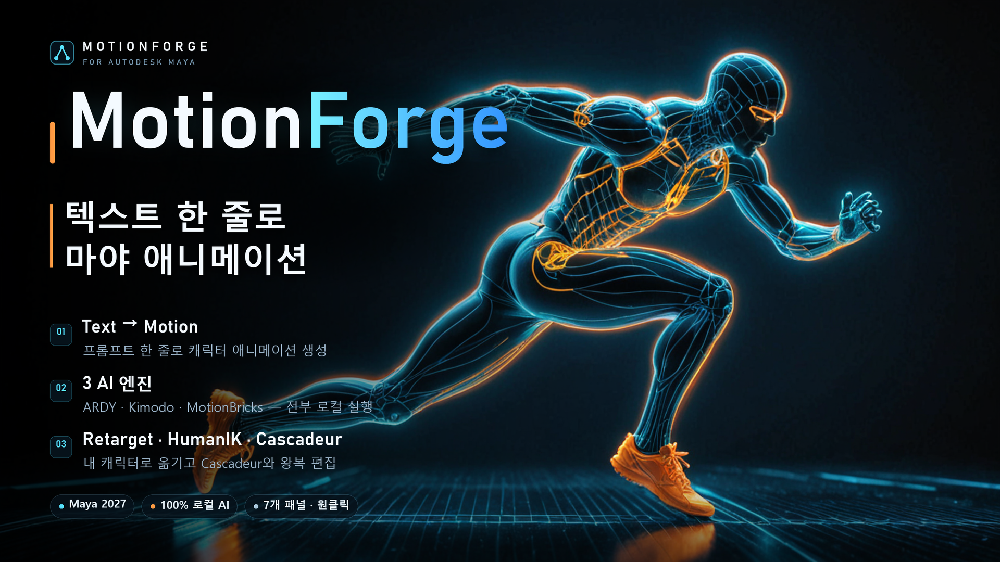

# MotionForge for Maya — 사용 가이드

텍스트 한 줄로 캐릭터 모션을 만들고, 내 캐릭터에 옮기고, Cascadeur로 보내는 Maya 플러그인입니다.
Blender 애드온 MotionForge v0.5.0을 Maya 2027로 이식했습니다. 모든 엔진은 **내 컴퓨터에서** 돌아가며 인터넷으로 아무것도 보내지 않습니다.

> English: [index.md](index.md)



---

## 1. 준비물

| 항목 | 내용 |
| --- | --- |
| Maya | Maya 2027 (Windows 64비트) |
| 엔진 | MotionForge 엔진 폴더 (ARDY · Kimodo · MotionBricks) — Blender 애드온과 같은 폴더를 함께 써도 됩니다 |
| GPU | ARDY는 GPU(Vulkan)를 쓰면 빠릅니다. 없으면 CPU로 동작합니다 |
| Cascadeur | 선택 사항. Cascadeur로 보내거나 실시간으로 볼 때만 필요합니다 |

---

## 2. 설치

### 2-1. 모듈 등록 (한 번만)

배포 파일을 항상 쓸 폴더에 풉니다 (예: `C:\Users\<사용자>\Documents\maya\modules\MotionForge`).
`MotionForge.mod`는 그 폴더의 맨 위에 그대로 두세요 — 바로 옆의 `scripts\`, `plug-ins\` 폴더를 가리키고 있어서
`.mod` 파일만 복사하면 동작하지 않습니다. 폴더 위치는 아무 데나 좋습니다 — 문서 폴더가 OneDrive로
리디렉션되어 있다면 탐색기에 보이는 실제 경로를 쓰세요.

그다음 그 폴더를 `MAYA_MODULE_PATH`에 넣습니다. 방법은 둘 중 하나입니다.

- **환경 변수**: Windows > 시스템 속성 > 환경 변수 > 사용자 변수 새로 만들기 —
  `MAYA_MODULE_PATH` = `C:\Users\<사용자>\Documents\maya\modules\MotionForge`.
  이미 있으면 뒤에 `;C:\Users\<사용자>\Documents\maya\modules\MotionForge`를 이어 붙입니다.
- **Maya.env**: 해당 버전의 `Maya.env` 파일(예: `C:\Users\<사용자>\Documents\maya\2027\Maya.env`)에
  같은 줄을 추가합니다.

  ```
  MAYA_MODULE_PATH = C:\Users\<사용자>\Documents\maya\modules\MotionForge
  ```

Maya를 다시 시작하세요.

### 2-2. 플러그인 켜기

`Windows > Settings/Preferences > Plug-in Manager`에서 **MotionForge**의 **Loaded**를 켭니다. 매번 켜지게 하려면 **Auto load**도 켜세요.
메뉴 바에 **MotionForge** 메뉴가 생기면 성공입니다.

### 2-3. 셸프 (선택)

Script Editor의 Python 탭에서 한 번 실행합니다.

```python
exec(open(r"C:\Users\<사용자>\Documents\maya\modules\MotionForge\scripts\motionforge_shelf.py").read())
```

**MotionForge** 셸프가 생깁니다: `Load` · `Window` · `Connect` · `Rig` · `Generate` · `Kimodo` · `MB` · `Retarget` · `Reload`.
여러 번 실행해도 셸프가 중복되지 않습니다.

---

## 3. 처음 설정 — 엔진 폴더

`MotionForge > Set Engine Folder...`에서 엔진 폴더를 고릅니다. 폴더 안은 이렇게 생겼습니다.

```
<엔진 폴더>\
├── ardy\          ARDY (bin\ardy-server.exe, models\*.gguf, assets\cskel27\)
├── kimodo\        Kimodo (생성기 + 텍스트 인코더)
└── motionbricks\  MotionBricks (DLL + 스타일)
```

`MotionForge > Engine Status`를 누르면 Script Editor에 엔진마다 `ready` 또는 빠진 것이 출력됩니다.

---

## 4. 화면 구성

| 위치 | 하는 일 |
| --- | --- |
| **MotionForge 메뉴** | 창 열기, ARDY 연결·끊기, 리그 만들기, 원클릭 생성(ARDY · Kimodo · MotionBricks), 리타겟, 엔진 폴더, **Engine Status**, 엔진 설치, Cascadeur 플러그인 설치, Reload, About |
| **셸프** | 메뉴와 같은 원클릭 기능 |
| **MotionForge 창** | 전체 기능. `Open MotionForge Window`(셸프 `Window`)로 열면 오른쪽에 도킹됩니다. 떼어내기·탭 합치기 가능 |

창에는 Blender와 **같은 순서, 같은 이름**으로 7개 패널이 있고, 모든 버튼이 동작합니다.

1. MotionForge — 엔진, 연결, 리그, HumanIK
2. Text to Motion — 텍스트로 테이크 만들기
3. Live Path — 실시간 조종
4. Kimodo — Kimodo 엔진 (여러 캐릭터)
5. MotionBricks — 걷기 엔진 (여러 캐릭터, 라이브, 스타일)
6. Retarget — 내 캐릭터에 옮기기
7. Send to Cascadeur — Cascadeur로 보내고 받아오기

창의 모든 설정과 목록(테이크, 웨이포인트, 포즈키, 라이브 테이크, Kimodo·MotionBricks 캐릭터, Share 목록)은 **씬과 함께 저장**됩니다. 씬을 다시 열면 그대로 돌아옵니다.

맨 위의 한 줄에 방금 누른 버튼의 결과나 오류가 표시됩니다.


---

## 5. 첫 번째 애니메이션 (5분)

1. `MotionForge > Connect ARDY` — 모델을 불러옵니다 (수 초).
2. `MotionForge > Create Rig` — 27관절 리그와 몸 메쉬가 생깁니다.
3. `MotionForge > Generate Motion...` — 프롬프트에 `a person walks forward`를 입력합니다.
4. 키프레임이 들어가고, 씬이 엔진 속도(ARDY는 20fps)와 실시간 재생으로 맞춰집니다. 재생해 보세요.

> 첫 생성은 텍스트 인코더를 준비하느라 오래 걸릴 수 있습니다 (이 PC 기준 약 100초). 두 번째부터는 빠릅니다.
> 창의 Generate 버튼은 **백그라운드**로 생성하므로 그동안에도 Maya를 계속 쓸 수 있습니다. 진행 상황은 상태 줄에 나옵니다.

---

## 6. 패널별 사용법

### 6-1. MotionForge — 엔진, 연결, 리그


| 컨트롤 | 설명 |
| --- | --- |
| **Engines** 상자 | 세 엔진의 상태(`ready` 또는 빠진 것)와 엔진 폴더 |
| **Set Engine Folder** | 엔진 폴더 지정 |
| **Install Engines** | 엔진 다운로드(백그라운드, 진행률 표시, 다시 누르면 중지). 엔진 다운로드 목록 파일이 이 저장소에 없으면 그렇다고 알려 줍니다 — 그 경우 Blender 애드온으로 설치한 엔진 폴더를 그대로 지정하면 됩니다 |
| **Install Cascadeur Plug-in** | `install_mf_maya.bat` 실행 (관리자 권한 요청) |
| **Connect ARDY / Disconnect** | ARDY 엔진을 켜고 끕니다 (연결도 백그라운드). 끄면 GPU 메모리가 비워집니다 |
| **Skip Text Encoder** | 텍스트 인코더 없이 연결합니다 (프롬프트 생성은 안 됨, 빠름) |
| **Ping** | ARDY 엔진이 응답하는지와 응답 시간 |
| **Create Rig / Create Skin** | 엔진 골격으로 조인트 리그를 만들고, 몸 메쉬를 붙입니다 |
| **HumanIK Character** | 켜 두면 새로 만드는 모든 리그(ARDY · Kimodo · MotionBricks)를 **HumanIK 캐릭터로 정의**합니다 |
| **Generated Rigs / Use Rig** | 만든 리그 목록. 고른 리그를 생성 대상으로 씁니다 |
| **Define as HumanIK** | 선택한 리그(또는 내 캐릭터의 조인트)를 HumanIK 캐릭터로 정의합니다. 내 캐릭터는 Retarget의 Rig Type으로 뼈 이름을 해석합니다 |
| **Control Rig** | HumanIK Control Rig(FK/IK 컨트롤)를 만듭니다 |

#### mGear (설치되어 있으면)

[mGear](https://mgear-framework.com)(오픈소스, MIT)를 마야에 설치해 두면 MotionForge 캐릭터에 **mGear EPIC 바이패드 컨트롤 리그**를 씌울 수 있습니다. AI가 만든 테이크가 mGear 컨트롤(FK·IK 모두)에 키로 들어가고, 캐릭터는 그 컨트롤을 따라 움직입니다. 생성된 모션을 일반 키프레임 작업처럼 다듬을 수 있습니다. mGear가 없으면 이 버튼들은 비활성화되고 이유가 표시됩니다.

| 버튼 | 설명 |
| --- | --- |
| **Build mGear Rig** | 선택한 캐릭터(조인트 아무거나)에 mGear 가이드를 맞추고 리그를 빌드합니다. 테이크가 있으면 바로 컨트롤에 베이크하고 연결합니다. 77관절이면 손가락 컨트롤까지 만듭니다 |
| **Bake Take to mGear** | 새로 만든 테이크를 컨트롤에 다시 베이크합니다 (팔다리는 FK와 IK 모두 — `arm_blend` / `leg_blend`로 바로 전환 가능) |
| **Connect / Disconnect** | 컨트롤이 캐릭터를 움직이게 / 캐릭터가 자기 키로 다시 재생하게 |
| **Remove** | mGear 리그와 가이드를 지웁니다. 캐릭터의 키는 남습니다 |

- mGear는 한 씬에 바이패드 하나만 빌드합니다. 다른 캐릭터에 쓰려면 먼저 Remove 하세요.
- 무릎·팔꿈치처럼 경첩으로 굽는 관절은 FK와 IK 모두 원래 동작과 0.5cm 이내로 맞습니다. IK 다리·팔의 폴 벡터는 매 프레임 실제로 굽는 평면에 놓입니다.

### 6-2. Text to Motion — 테이크


**테이크**는 한 번의 생성 단위입니다. 각자 프롬프트·길이·시드·대상 리그·경로 커브를 가집니다. 테이크가 없으면 "Start here" 안내가 나옵니다.

| 컨트롤 | 설명 |
| --- | --- |
| **+ / -** | 테이크 추가·삭제. 새 테이크는 앞 테이크의 프롬프트와 길이를 복사합니다 |
| **Use Take** | 생성해 둔 테이크를 그 리그에 다시 올립니다 |
| **Prompt / Preset** | 동작 설명. Preset에서 예시 문장을 고를 수 있습니다 |
| **Source Rig** | 이 테이크가 들어갈 리그. `(active source)`면 활성 리그 |
| **Duration / Seed** | 길이(초) / `-1`이면 매번 다르게, 숫자를 넣으면 같은 결과 |
| **Include in Generate All** | 끄면 Generate All에서 빠집니다 |
| **Continue from the take above** | 위 테이크의 끝 동작에서 이어서 만듭니다 |
| **Create Curve / Disconnect Curve** | 이 테이크 전용 경로(NURBS 커브)를 만들거나 연결을 끊습니다. 커브가 있으면 웨이포인트 대신 커브를 따라 걷습니다 (Face Waypoint Direction이 켜져 있으면 커브 방향을 바라봄) |
| **Reduce Foot Skating** | 발 미끄러짐 보정 (꺼져 있으면 웨이포인트·포즈키가 대략적으로만 맞는다고 경고) |
| **Denoising Steps / Prompt Strength / Constraint Strength** | 생성 품질과 조건을 따르는 강도 |
| **Generate Take / Generate All (n)** | 선택한 테이크 / 켜져 있는 모든 테이크. 생성 중에는 Generate All 버튼이 **Stop**이 됩니다 |
| **Stream to Unreal / Stream Port** | 만든 테이크를 언리얼로 실시간 전송 (6-3 참고) |

**웨이포인트 — "이 프레임에 여기를 지나가라"**

1. **Follow Waypoints**를 켭니다.
2. 타임라인을 원하는 프레임에 두고 **+** 를 누르면 `MF_Waypoint_01` 로케이터가 생깁니다 (선택한 물체 위치 또는 원점, 리그가 바라보는 방향으로).
3. 목록에서 고르고 **Frame / Enabled**로 프레임과 사용 여부를 고칠 수 있습니다.
4. **Face Waypoint Direction**을 켜면 로케이터의 +Z 방향을 바라보게 합니다.
5. 웨이포인트는 **리그 기준**으로 읽습니다. 리그를 그룹에 넣고 옮기거나 돌려도 놓은 자리로 걸어갑니다.

**포즈 키 — "이 프레임에 이 자세를 취해라"**

1. **Use Pose Keys**를 켭니다.
2. 원하는 프레임에서 **+** 를 누르면 리그 복사본 `MF_Pose_001`이 생깁니다.
3. **Pose Key**(키를 고르면 **Pose <rig>**) 버튼 — 그 프레임으로 가서 포즈 리그를 선택합니다.
4. **IK On** — 팔·다리에 Maya ikHandle(회전 평면 + 폴 벡터)을 달아 손·발로 자세를 잡습니다. **IK Off**를 누르면 잡은 자세는 관절에 남고 핸들은 지워집니다.
5. **Pin**: `Whole Body`(전신 고정) / `Parts`(LH·RH·LF·RF 중 고른 손발만 고정, 나머지는 모델이 만듦).
6. Generate Take.

### 6-3. Live Path — 실시간 조종


캐릭터가 걷는 동안 콘(원뿔)을 끌어 방향을 바꿉니다. 키는 **Bake**를 누를 때만 들어갑니다.

1. ARDY가 연결되어 있어야 합니다.
2. **+** 로 라이브 테이크를 추가하고 Prompt·Rig·Seed·Enabled를 정합니다.
3. **Add Target** — 조종용 콘 `MF_Live_Target_1`이 생기고 선택됩니다.
4. **Start Live** — 콘을 끌거나 돌리세요. **Esc** 또는 **Stop Live**로 멈춥니다.
5. **Bake**(키로 기록) 또는 **Discard**(버리기). **Reset All**은 ARDY 리그의 키를 지우고 쉬는 자세(T포즈)로 되돌리며, 타임라인을 첫 프레임으로 돌립니다. 리타겟해 둔 캐릭터(6-6)도 함께 리셋됩니다.
6. Share 목록(6-6)에 캐릭터가 있으면 라이브 중에 **함께 따라 움직입니다** (키 없이 자세만). Bake하면 키로 채워집니다.

| 옵션 | 설명 |
| --- | --- |
| **Stop After** | 이 초만큼 만들면 자동으로 멈춥니다 (`0`이면 계속) |
| **Face Target Direction** | 콘의 끝 방향을 바라보게 합니다 |
| **Stream to Unreal / Stream Port** | 만들어지는 모션을 TCP(기본 9560)로 내보냅니다. 한 줄에 JSON 하나(hello / frame / end), 관절마다 축-각 회전 + 루트 위치(m, Y-up). 언리얼 Live Link, Unity 등에서 받을 수 있습니다 |
| **Export Rig for Unreal (FBX)** | 스트림을 받을 골격을 FBX(cm, 몸 메쉬 포함)로 저장합니다. 언리얼에서 가져와 Live Link Pose 노드로 구동하세요 |

### 6-4. Kimodo


Kimodo는 테이크마다 엔진을 따로 실행합니다. 한 테이크에 수십 초~수 분 걸리며, **백그라운드**로 돌아갑니다.

1. **With a Body / With Fingers**를 고르고 **+** 로 캐릭터를 만듭니다.
   - With Fingers를 끄면 30관절, 켜면 손가락까지 77관절입니다.
   - 몸: 77관절은 ARDY의 실제 스킨, 30관절은 관절 위에 씌운 간단한 몸(프록시)입니다.
2. 캐릭터마다 **Enabled · Prompt · Seed**를 따로 정합니다 (목록에서 골라 편집).
3. **-** 는 목록에서 빼기 또는 씬에서 삭제(물어봄), **Add Selected**는 씬에서 고른 SOMA 골격(BVH·FBX로 가져온 것 포함)을 목록에 넣습니다.
4. Duration · Denoising Steps(기본 20) · Prompt Strength · Constraint Strength · Reduce Foot Skating 등을 정하고 **Generate Motion** — 켜진 캐릭터마다 차례로 생성되고, 다 된 것부터 키가 들어갑니다. 생성 중 버튼은 **Stop Waiting**이 됩니다 (진행 중인 테이크는 끝까지 갑니다).
5. **Reset All** — 목록의 모든 Kimodo 캐릭터 키를 지우고 쉬는 자세(T포즈)로 되돌리며, 타임라인을 첫 프레임으로 돌립니다. 테이크를 리타겟해 둔 캐릭터(6-6)도 함께 리셋됩니다.
6. **Export SOMA BVH** / **Reload Engine**.

### 6-5. MotionBricks — 걷기


입력 없이 스타일대로 걷게 합니다. **Generate Motion**은 계획만 세우고 **바로 재생됩니다** (메모리에서 미리보기). **Bake**를 눌러야 키가 들어갑니다.

| 컨트롤 | 설명 |
| --- | --- |
| **+ / - / Add Selected** | 캐릭터 만들기(대기 자세로 섬) / 빼기·삭제 / 고른 골격을 목록에 넣기 |
| **With a Body** | 새 캐릭터에 간단한 몸 메쉬를 붙입니다 |
| **Style** | 로드된 스타일 목록에서 고릅니다 |
| **Go** | `In a Direction`(방향으로 계속 걷기) / `To a Target`(목표로 가서 멈추기) |
| **Target / +** | 목표 오브젝트 이름 또는 `x z`(씬 단위). **+** 는 화살표 목표를 만들어 줍니다 — 화살표 +Z가 도착 후 바라볼 방향 |
| **Heading (deg) / Speed / Seed** | 방향(도) / `0`이면 스타일 속도 / 스타일 시작 위치 |
| **Duration / Reduce Foot Skating / Continue** | 길이 / 발 고정 / 이전 계획 뒤에 이어 붙이기 |
| **Live** | **Steer With**: `Ground Cursor`(**Cursor Tool**로 바닥을 클릭하거나 `MF_MB_Cursor`를 끌면 그쪽으로 걸어감) / `Target Object`(각자 목표로). **Move Characters Too**: Share 목록 캐릭터가 함께 움직임. **Lead**: 미리 계획할 프레임 수. **Esc**로 멈춤 |
| **Cascadeur** | Cascadeur 링크 상태, **Connect/Disconnect**, **Refresh** |
| **Bake / Discard** | 계획을 키로 기록 / 버리기 |
| **Reset All** | 라이브를 멈추고 대기 중인 계획을 버린 뒤, 목록의 모든 MotionBricks 캐릭터 키를 지우고 쉬는 자세로 되돌립니다. 리타겟해 둔 캐릭터도 함께 리셋됩니다. 타임라인은 첫 프레임으로 |
| **Styles** | **Style Name · Speed · Allowed Durations**. **Import FBX / BVH**로 모션 파일을 가져오고(가져온 파일의 최상위 노드는 **Source**, 뼈 이름 체계는 **Rig Type**에 표시됩니다) **Convert to Style**로 `.mbstyle`을 만듭니다 (MotionBricks 골격으로 리타겟 후 저장, 엔진이 어떻게 걷는지 바로 확인해서 알려 줌). **Save as Style**은 선택한 캐릭터의 애니메이션(재생 범위)을 스타일로 저장 |
| **Reload Engine** | 엔진을 다시 불러옵니다 |

> Maya에는 BVH 가져오기가 없어서 MotionForge가 직접 읽습니다 (회전 순서, fps 포함).

### 6-6. Retarget — 내 캐릭터에 옮기기


1. **Source Rig** — 비워 두면 가장 최근에 테이크를 넣은 리그. 목록에서 다른 MotionForge 리그를 고를 수 있습니다. 라이브 테이크가 Bake 전이면 먼저 Bake하고, 키가 없는 리그는 현재 자세를 옮깁니다.
2. 받을 캐릭터의 조인트(또는 몸 메쉬)를 선택하고 **Set Selected** (또는 Target Rig에 이름). **네임스페이스가 붙은 참조 캐릭터**(`Hero:Hips`)도 그대로 됩니다. 가져온 툴이 골격을 몸 메쉬 아래에 나눠 둔 경우(MetaHuman Builder의 `MMB_bodyShapeBof4|spine_04`)에는 메쉬로 등록되고, 그 아래 모든 조인트가 리타겟됩니다. 몸 골격 옆에 같은 이름의 골격이 하나 더 있는 캐릭터(메타휴먼 헤드 리그)는 몸 골격을 구동하고 그 복제 골격이 이를 따라갑니다. 라이브·Bake 모두 그렇습니다.
3. **Rig Type**은 보통 자동 감지. 마야 애니메이터가 실제로 쓰는 컨트롤 리그 두 가지가 목록에 있습니다: **HumanIK Control Rig**와 **mGear EPIC 바이패드**. 테이크는 그 컨트롤에 키로 들어가고(골반과 다리는 HumanIK 이펙터로 — 이 솔버가 읽는 것은 그 채널입니다), 캐릭터는 컨트롤을 따라 움직입니다.
4. **Method** — `MotionForge`(관절별 복사) / `HumanIK (Maya)`(두 리그를 HumanIK 캐릭터로 정의하고 Maya HumanIK로 구동 후 베이크).
5. **Retarget to Character**.

| 옵션 | 설명 |
| --- | --- |
| **Auto-Align Rest Pose** | 팔다리 기본 자세가 달라도 맞춰서 옮깁니다 |
| **Auto Scale Motion** | 키가 다르면 이동 거리를 비율로 맞춥니다 |
| **Match Floor Contact** | 매 프레임 발이 바닥에 닿도록 높이를 맞춥니다 |
| **Legs on IK** (아래 Share With Characters 상자의 체크박스) | 발을 소스의 발 위치(캐릭터 자신의 골반 기준, 다리 길이 비율로)에 놓고 무릎을 2관절 IK로 풉니다. 체형이 달라도 발이 미끄러지지 않습니다. **Retarget to Character**에도 함께 적용됩니다 |

**Share With Characters** — 한 테이크를 여러 캐릭터에 자동으로

1. **+** — 선택한 캐릭터로 행을 추가합니다. 행마다 **Source**(비우면 활성 리그) · **Character** · **Rig Type** · **Enabled**.
2. **Fill Characters After Generating**이 켜져 있으면 Generate·Bake 직후 자동으로 채웁니다. **Fill Characters**는 지금 바로.
3. 라이브(ARDY·MotionBricks) 중에는 캐릭터가 자세로 따라옵니다. 같은 캐릭터의 두 번째 골격(메타휴먼 헤드 리그)도 함께 따라갑니다.

**Reset All**(Live Path·Kimodo·MotionBricks)은 이 캐릭터들도 함께 리셋합니다. 키를 지우고 캐릭터 **자신의 쉬는 자세 — 마야의 바인드 포즈**(Go to Bind Pose가 되돌리는 그 자세)로 돌아갑니다. 메타휴먼 바디는 바인드 당시의 자세 전체(루트에 -90)로 돌아가며, 회전 채널을 0으로 미는 방식이 아니므로 넘어져 바닥 아래로 내려가지 않습니다. 이 자세는 캐릭터가 지금 서 있는 모습이 아니라 **골격에 기록된 바인드 포즈**에서 읽습니다. 라이브 실행은 팔로워의 본을 키 없이 세팅하므로, 중간에 멈춘 캐릭터는 애니메이션이 전혀 없는 것처럼 보이는데, 그 자세를 쉬는 자세로 기억해서 리셋이 테이크가 가 있던 곳으로 걸어가 버렸습니다. 바인드 포즈가 아예 없는 골격(MotionForge가 만들고 스킨하지 않은 리그)은 처음 봤을 때의 자세로, MotionForge가 보기 전에 이미 키가 있던 캐릭터는 테이크가 시작하는 지점으로 돌아갑니다. 행과 Target Rig는 씬에 저장되므로, 이전 세션에서 채워 둔 캐릭터도 되돌아갑니다.

**SMPL-X body** — Target Rig가 SMPL-X/SMPL-H 골격이면 **Export SMPL (.smpl)**로 내보냅니다 (Gender 선택, 블렌드셰이프 `Shape000…`이 있으면 체형도 저장).

### 6-7. Send to Cascadeur


7장을 보세요.

---

## 7. Cascadeur 연동

### 7-1. 설치 (한 번만)

1. 창의 **Install Cascadeur Plug-in**(또는 메뉴) — `installer\integrations\cascadeur\install_mf_maya.bat`을 실행합니다. 관리자 권한을 물으면 허용하세요.
   - 마야 전용 파일 2개(`mf_maya_link.py`, `mf_maya_apply.py`)를 Cascadeur에 복사합니다.
   - Blender 애드온의 Cascadeur 플러그인과 **파일 이름도 포트도 겹치지 않습니다.** 둘을 같이 설치하고 동시에 켜도 됩니다.
2. Cascadeur를 다시 시작합니다.
3. Cascadeur의 `Animation Scripts > MotionForge Maya Link`를 실행합니다 (포트 9574).

보낼 대상은 **선택한 골격**입니다. MotionForge 리그뿐 아니라 내 캐릭터의 조인트를 골라도 됩니다. 아무것도 고르지 않으면 가장 최근에 테이크를 넣은 리그입니다.

### 7-2. 보내기

| 컨트롤 | 설명 |
| --- | --- |
| **Send** | `Keyframes Only`(Cascadeur에 이미 있는 캐릭터에 키만) / `Character and Bones`(캐릭터 자체를 FBX로) |
| **With Mesh / With Animation** | 캐릭터를 보낼 때 몸 메쉬·애니메이션 포함 여부 (애니메이션을 끄면 쉬는 자세로 보냄) |
| **Unify Skeleton** | 메쉬가 스킨된 관절이 여러 계층에 흩어져 있거나 컨트롤 리그(컨스트레인트·IK·HumanIK)로 움직이면, 스킨 관절만으로 **하나의 골격 복사본**을 만들고 동작을 베이크해서 보냅니다. 내 씬은 그대로입니다 |
| **Fill Rig Mode** (체크) | 캐릭터가 Cascadeur에 다 열리면 Quick Rigging Tool을 이 리그의 관절로 자동으로 채웁니다 |
| **Rig Type** (Keyframes Only) | 뼈 이름 체계. 아래에 "N bones matched" 또는 이유가 나옵니다 |
| **Send Frame Range / Current Frame** | 재생 범위 전체 / 지금 프레임 |
| **Status** | Cascadeur가 받은 프레임 수 |
| **Fill Rig Mode** (버튼) | 이미 보낸 캐릭터에 Rig Mode를 지금 채웁니다 |

> **순서가 중요합니다**: Cascadeur에 캐릭터가 없다면 먼저 `Character and Bones`로 보내고, 그다음 키·Live·받아오기를 쓰세요. 보낼 때 Cascadeur가 기록한 도착 자세를 리그에 저장해 두므로, Cascadeur나 Maya를 재시작해도 받아오기가 맞습니다.

### 7-3. 실시간 미러 (Live)

1. **Check the Link** — 링크를 한 단계씩 시험해서 어디서 막히는지 보고합니다 (Script Editor에 전체).
2. **Mirror** — `Follow the Focus`(작업 중인 창 쪽이 보냄) / `Maya to Cascadeur` / `Cascadeur to Maya`.
3. **Bones** — `Mapped Bones` / `Whole Skeleton`.
4. **Live: Mirror This Rig** — 다시 누르거나 **Esc**로 멈춥니다. 재생하면 프레임마다 Cascadeur에도 키가 들어갑니다.

### 7-4. 받아오기 (From Cascadeur)

| 컨트롤 | 설명 |
| --- | --- |
| **Receive** | `Animation Only`(선택한 골격에 키만) / `Mesh + Animation`(Cascadeur가 FBX로 내보내고 Maya가 새 오브젝트로 가져옴) |
| **Whole Take** | Cascadeur의 모든 프레임. 끄면 씬 재생 범위만 |
| **Timing** | `Match Timing`(보낸 속도 그대로 — Cascadeur fps 차이를 되돌림) / `Fit Scene Range`(씬 범위에 맞춰 늘이고 줄임) / `One For One`(프레임 그대로) |
| **Receive from Cascadeur** | 가져오기 |

---

## 8. Maya에서 알아두면 좋은 동작

| 상황 | MotionForge의 동작 |
| --- | --- |
| **씬 단위가 cm가 아님** (m, inch 등) | 그대로 정확하게 동작합니다. 작업하는 동안만 cm로 계산하고 씬 단위는 원래대로 돌려 놓습니다 |
| **실행 취소** | 리그 만들기 · 테이크 키 넣기 · Bake · 리타겟 · 받아오기는 각각 **Ctrl+Z 한 번**으로 되돌아갑니다 |
| **씬 fps** | 빈 씬이면 테이크 속도로 맞춥니다 (ARDY 20 · Kimodo/MotionBricks 30). 다른 애니메이션이 이미 있으면 씬 fps는 **그대로 두고**, 테이크를 실제 시간에 맞춰 키를 넣습니다 |
| **재생이 너무 빠름** | 재생 모드가 "Play every frame"이면 자동으로 Real-time으로 바꿉니다 |
| **같은 리그에 다시 생성** | 이전 테이크의 키를 지우고 새로 넣습니다 |
| **회전이 180°를 넘음** | 오일러 필터가 자동으로 적용됩니다 |
| **씬 저장 후 다시 열기 / Maya 재시작** | 리그와 함께 창의 모든 설정·목록이 돌아옵니다 (`motionforgeState` 노드). 조인트 이름을 바꿔도 찾습니다 |
| **리그를 그룹에 넣고 옮김** | 모션은 리그 자신의 공간에서 움직입니다. 그룹을 옮기거나 돌리면 테이크도, 웨이포인트·목표도 함께 따라갑니다 |
| **다른 곳에서 가져온 골격** (관절 방향이 제각각) | Add Selected로 넣으면 각 관절의 기본 방향을 기억해서 정확히 키를 넣습니다 |
| **씬에 같은 이름의 노드가 있음** | 겹치지 않는 이름으로 리그를 만듭니다 |
| **임시 파일** | 7일 지난 생성·전송 파일은 플러그인을 켤 때 자동으로 지워집니다 (Use Take는 그 안에서만 가능) |

---

## 9. Reload — Maya 재시작 없이 업데이트

`MotionForge > Reload MotionForge` (셸프 `Reload`)
새 코드를 바로 반영합니다. 실행 중이던 Live, MotionBricks 라이브, Cascadeur 미러는 먼저 멈추고, ARDY 연결은 끊깁니다.
리그·테이크·웨이포인트·포즈키·라이브 목록·Kimodo/MotionBricks 캐릭터·Share 목록·설정은 그대로 남습니다. Reload 후 창을 다시 여세요.

---

## 10. Blender와 다른 점

이식되지 않은 기능은 없습니다. 창의 모든 버튼이 동작합니다. 다만 Maya에 맞게 바뀐 부분이 있습니다.

| Blender | Maya |
| --- | --- |
| 3D 커서 (Shift+우클릭) | `MF_MB_Cursor` 로케이터 + **Cursor Tool**(바닥 클릭) |
| Rigify 팔다리 IK 구동 (Legs on IK) | 캐릭터 자신의 다리에서 푸는 2관절 IK. 추가로 **HumanIK 리타겟** 방식 제공 |
| Rigify 3중 골격 합치기 (Unify Skeleton) | 스킨 관절만으로 하나의 골격 복사본을 만들고 컨트롤 리그 동작을 베이크 |
| 포즈키 IK 본 | Maya ikHandle + 폴 벡터 로케이터 |
| 경로 커브 (Bezier) | NURBS 커브 |
| BVH 가져오기 (Blender 내장) | MotionForge 자체 BVH 리더 |
| Rigify 컨트롤 리그 | **mGear EPIC 바이패드**(mGear 설치 시) 또는 **HumanIK Control Rig** |
| 엔진 설치 (애드온에 다운로드 목록 포함) | 이 저장소에는 다운로드 목록이 없습니다. Blender 애드온으로 설치한 엔진 폴더를 그대로 지정하세요 |

---

## 11. 문제 해결

| 메시지 / 증상 | 해결 |
| --- | --- |
| `ARDY is not installed under the Engine Folder` | `Set Engine Folder...`로 엔진 폴더를 지정하고 `Engine Status`로 확인하세요 |
| `Create a rig first` / 리그가 없다는 메시지 | `Create Rig`(또는 각 패널의 `+`)로 리그를 만드세요 |
| `The take has N joints but the rig has M` | 다른 모델로 만든 리그입니다. `Create Rig`를 다시 누르세요 |
| Live 상태가 `engine off - press Connect ARDY first` | `Connect ARDY`를 먼저 누르세요 |
| `Cascadeur is not listening on ...` | Cascadeur에서 `MotionForge Maya Link`를 실행하세요 |
| `This Cascadeur's plugin has no ...` (404) | Cascadeur 쪽 파일이 오래됐습니다. `install_mf_maya.bat`을 다시 실행하고 Cascadeur를 재시작하세요 |
| 연결 후 `stale` (Cascadeur 링크 버전이 다름) | `install_mf_maya.bat`을 다시 실행하고 Cascadeur를 재시작하세요 |
| 생성이 오래 걸림 | 창의 생성은 백그라운드로 돕니다. 첫 프롬프트는 오래 걸립니다. 상태 줄과 Script Editor에서 진행 상황을 확인하세요 (메뉴의 원클릭 생성은 끝날 때까지 기다립니다) |
| Reload 후 창이 비어 있음 | `Open MotionForge Window`로 창을 다시 여세요 |

---

## 12. 라이선스

MotionForge for Maya는 **참이슬 라이선스**로 판매되며, 구매자 1인당 라이선스 1개입니다.
복제·수정·배포·재배포·재판매는 허용되지 않으며, 제공된 파일 그대로만 사용해야 합니다.
전문은 설치한 폴더의 `LICENSE.txt`에 있습니다.

제3자 구성 요소(NVIDIA 모델·소스, ggml)는 각자의 라이선스를 그대로 따르며 수정하지 않습니다:
`licenses\` 및 `scripts\motionforge\core\installer\*\licenses\` 참조.
Blender 애드온의 라이선스는 이 제품에 적용되지 않습니다.
