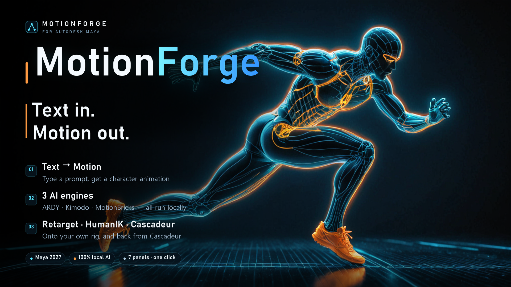
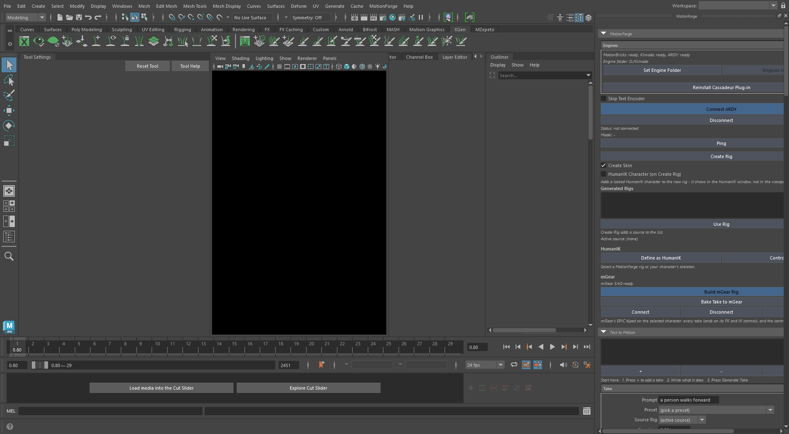
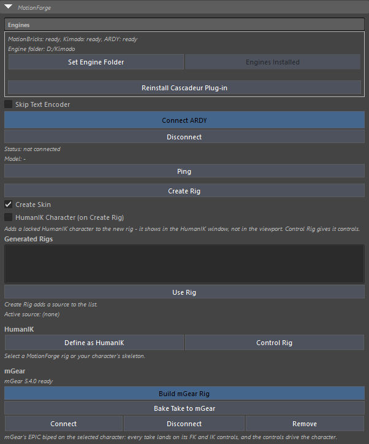
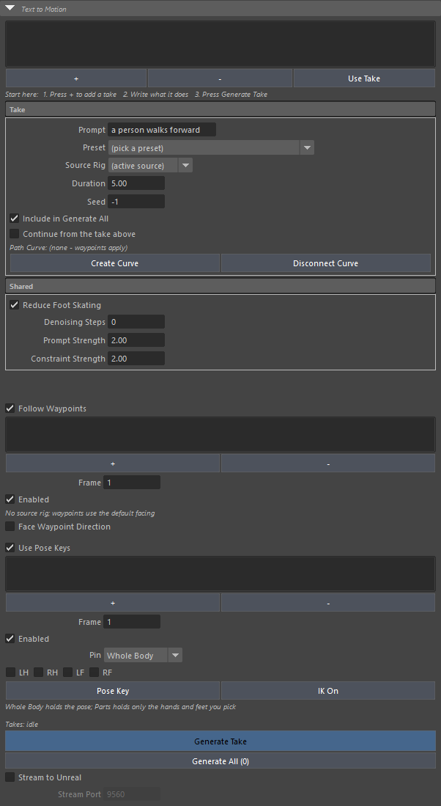
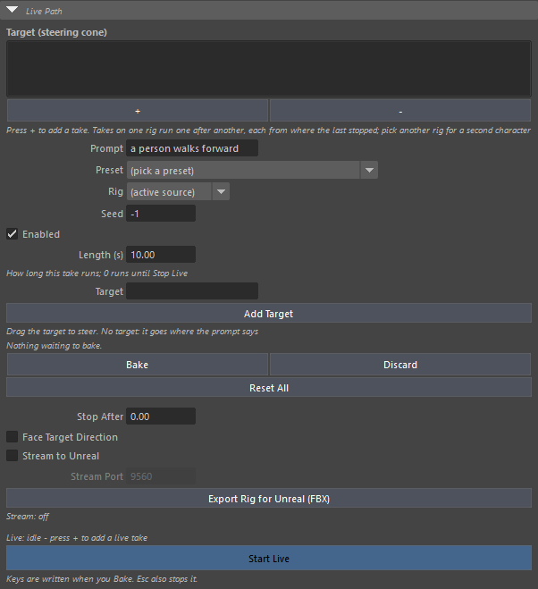
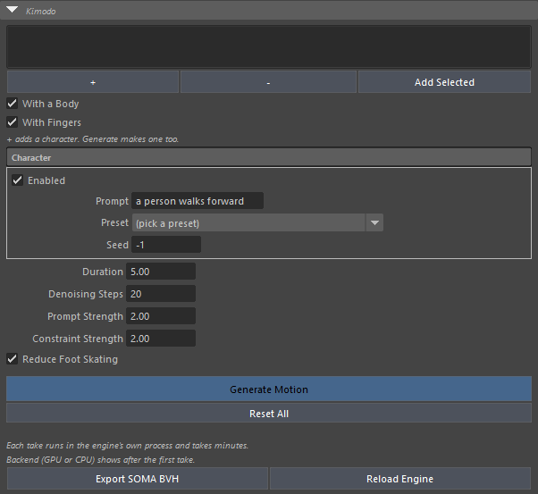
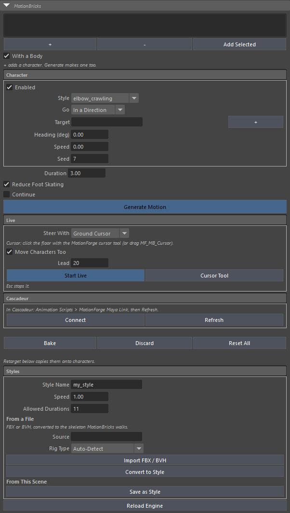
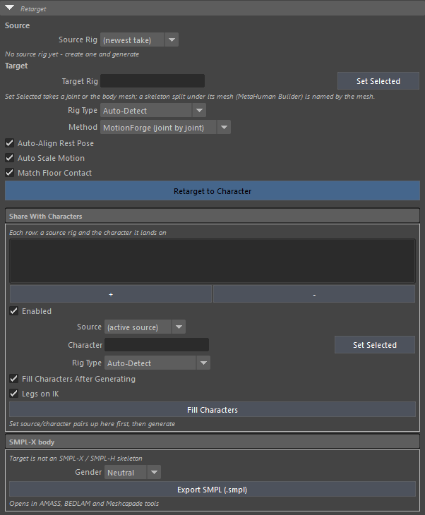
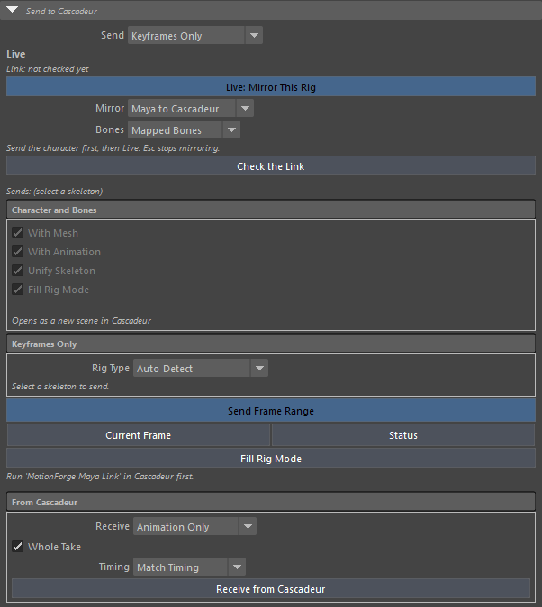

# MotionForge for Maya — User Guide

A Maya plug-in that turns one line of text into character motion, moves it onto your own character, and sends it to Cascadeur.
It is a port of the MotionForge Blender add-on v0.5.0 to Maya 2027. Every engine runs **on your own computer**; nothing is sent over the internet.

> 한국어: [KO_index.md](KO_index.md)



---

## 1. What you need

| Item | Details |
| --- | --- |
| Maya | Maya 2027 (Windows, 64-bit) |
| Engines | A MotionForge Engine Folder (ARDY · Kimodo · MotionBricks) — the same folder the Blender add-on uses works |
| GPU | ARDY is fast on a GPU (Vulkan); without one it runs on the CPU |
| Cascadeur | Optional. Only needed to send motion to Cascadeur or watch it live there |

---

## 2. Installation

### 2-1. Register the module (once)

Unzip the distribution into a permanent folder, e.g. `C:\Users\<you>\Documents\maya\modules\MotionForge`.
Keep `MotionForge.mod` at the root of that folder: it points at the `scripts\` and `plug-ins\` folders beside it,
so copying the `.mod` on its own will not work. Any folder will do - if your Documents folder is redirected
to OneDrive, use the path Explorer shows you.

Then put that folder on `MAYA_MODULE_PATH`, one of two ways:

- **Environment variable**: Windows > System Properties > Environment Variables > New user variable
  `MAYA_MODULE_PATH` = `C:\Users\<you>\Documents\maya\modules\MotionForge`. If it already exists, append
  `;C:\Users\<you>\Documents\maya\modules\MotionForge`.
- **Maya.env**: add the same line to the `Maya.env` file of your Maya version
  (e.g. `C:\Users\<you>\Documents\maya\2027\Maya.env`):

  ```
  MAYA_MODULE_PATH = C:\Users\<you>\Documents\maya\modules\MotionForge
  ```

Restart Maya.

### 2-2. Load the plug-in

In `Windows > Settings/Preferences > Plug-in Manager`, tick **Loaded** for **MotionForge**. Tick **Auto load** too if you want it every session.
A **MotionForge** menu appears in the menu bar.

### 2-3. Shelf (optional)

Run once in the Script Editor's Python tab:

```python
exec(open(r"C:\Users\<you>\Documents\maya\modules\MotionForge\scripts\motionforge_shelf.py").read())
```

This creates the **MotionForge** shelf: `Load` · `Window` · `Connect` · `Rig` · `Generate` · `Kimodo` · `MB` · `Retarget` · `Reload`.
Running it again does not duplicate the shelf.

---

## 3. First-time setup — the Engine Folder

Choose the Engine Folder with `MotionForge > Set Engine Folder...`. Inside it:

```
<Engine Folder>\
├── ardy\          ARDY (bin\ardy-server.exe, models\*.gguf, assets\cskel27\)
├── kimodo\        Kimodo (generator + text encoder)
└── motionbricks\  MotionBricks (DLL + styles)
```

`MotionForge > Engine Status` prints `ready` (or what is missing) for each engine in the Script Editor.

---

## 4. Where things are

| Where | What it does |
| --- | --- |
| **MotionForge menu** | Open the window, connect/disconnect ARDY, create a rig, one-click generation (ARDY · Kimodo · MotionBricks), retarget, Engine Folder, Engine Status, Install Engines, Install Cascadeur Plug-in, Reload, About |
| **Shelf** | The same one-click entries |
| **MotionForge window** | The full tool. `Open MotionForge Window` (shelf `Window`) docks it on the right; it can be floated or tabbed |

The window carries Blender's seven panels **in the same order, with the same names**, and every control works.

1. MotionForge — engines, connection, rigs, HumanIK
2. Text to Motion — takes from text
3. Live Path — steering in real time
4. Kimodo — the Kimodo engine (several characters)
5. MotionBricks — the walking engine (several characters, live, styles)
6. Retarget — onto your own character
7. Send to Cascadeur — to Cascadeur and back

Every setting and list in the window (takes, waypoints, pose keys, live takes, Kimodo and MotionBricks characters, the Share list) is **saved with the scene** and comes back when it is reopened.

The line at the top shows what the last button did, or why it failed.



---

## 5. Your first animation (5 minutes)

1. `MotionForge > Connect ARDY` — loads the model (seconds).
2. `MotionForge > Create Rig` — a 27-joint rig with its body mesh.
3. `MotionForge > Generate Motion...` — type `a person walks forward`.
4. The take is keyed and the scene is set to the engine's rate (ARDY: 20 fps) with real-time playback. Play it.

> The first generation can take a while while the text encoder warms up (about 100 s on this PC); later ones are quick.
> The window's Generate buttons run **in the background**, so Maya stays usable; the status line shows progress.

---

## 6. The panels

### 6-1. MotionForge — engines, connection, rigs



| Control | What it does |
| --- | --- |
| **Engines** box | Each engine's state (`ready` or what is missing) and the Engine Folder |
| **Set Engine Folder** | Choose the Engine Folder |
| **Install Engines** | Download the engines (in the background with progress; press again to stop). If this repository carries no engine download manifests it says so — point the Engine Folder at the one the Blender add-on installed |
| **Install Cascadeur Plug-in** | Runs `install_mf_maya.bat` (asks for Administrator) |
| **Connect ARDY / Disconnect** | Start and stop the ARDY engine (connecting runs in the background). Disconnecting frees GPU memory |
| **Skip Text Encoder** | Connect without the text encoder (no prompts, faster) |
| **Ping** | Whether ARDY answers, and how fast |
| **Create Rig / Create Skin** | A joint rig of the engine's skeleton, with its body mesh |
| **HumanIK Character** | When on, every new rig (ARDY · Kimodo · MotionBricks) is **defined as a HumanIK character** |
| **Generated Rigs / Use Rig** | The rigs made so far; the picked one becomes the generation target |
| **Define as HumanIK** | Define the selected rig — or your character's joints — as a HumanIK character. A character's joints are read with Retarget's Rig Type |
| **Control Rig** | Build the HumanIK Control Rig (FK/IK controls) |

#### mGear (when installed)

With [mGear](https://mgear-framework.com) (open source, MIT) installed in Maya, a MotionForge character can wear **mGear's EPIC biped control rig**. Generated takes are keyed onto the mGear controls (FK and IK both), and the character follows the controls, so generated motion is polished like any keyframed animation. Without mGear these buttons are greyed out with the reason shown.

| Button | What it does |
| --- | --- |
| **Build mGear Rig** | Fits mGear's guide onto the selected character (any joint of it) and builds the rig. A take already on it is baked onto the controls and connected. A 77-joint character gets finger controls too |
| **Bake Take to mGear** | Bakes a new take onto the controls (arms and legs in FK and IK both — switch with `arm_blend` / `leg_blend`) |
| **Connect / Disconnect** | The controls drive the character / the character plays its own keys again |
| **Remove** | Deletes the mGear rig and guide; the character keeps its keys |

- mGear builds one biped per scene. Remove it before rigging another character.
- With knees and elbows bending as hinges, FK and IK both match the original motion within 0.5 cm. IK poles are placed in the plane the limb actually bends in, frame by frame.

### 6-2. Text to Motion — takes



A **take** is one generation: its own prompt, length, seed, target rig and path curve. With no takes the panel shows a "Start here" line.

| Control | What it does |
| --- | --- |
| **+ / -** | Add or remove a take. A new take copies the previous one's prompt and length |
| **Use Take** | Put a generated take back on its rig |
| **Prompt / Preset** | What happens. Preset offers example sentences |
| **Source Rig** | The rig this take goes onto; `(active source)` is the active rig |
| **Duration / Seed** | Length in seconds / `-1` differs every time, a number repeats a result |
| **Include in Generate All** | Off leaves the take out of Generate All |
| **Continue from the take above** | Starts where the take above ended |
| **Create Curve / Disconnect Curve** | A path (NURBS curve) for this take alone, or disconnect it. A take with a curve walks the curve instead of the waypoints (facing along it with Face Waypoint Direction) |
| **Reduce Foot Skating** | Foot-skate fix (when off, a warning says waypoints and pose keys will only be approximate) |
| **Denoising Steps / Prompt Strength / Constraint Strength** | Quality and how hard prompt and constraints are followed |
| **Generate Take / Generate All (n)** | The selected take / every enabled take. While generating, Generate All becomes **Stop** |
| **Stream to Unreal / Stream Port** | Send the finished takes out live (see 6-3) |

**Waypoints — "pass through here on this frame"**

1. Turn on **Follow Waypoints**.
2. Put the time slider on a frame and press **+**: an `MF_Waypoint_01` locator appears (at the selected object or the origin, facing the way the rig faces).
3. Pick one in the list to change its **Frame / Enabled**.
4. **Face Waypoint Direction** makes the character face the locator's +Z.
5. Waypoints are read **relative to the rig**: put the rig in a group and move or turn the group, and it still walks to where they were placed.

**Pose keys — "hold this pose on this frame"**

1. Turn on **Use Pose Keys**.
2. On the frame you want, press **+**: a copy of the rig, `MF_Pose_001`, appears.
3. **Pose Key** (shown as **Pose <rig>** once a key is picked) jumps to the key's frame and selects its rig.
4. **IK On** gives the arms and legs Maya ikHandles (rotate-plane, with pole vectors) to pose by the hands and feet; **IK Off** keeps the pose in the joints and removes the handles.
5. **Pin**: `Whole Body` holds every joint; `Parts` holds only the hands and feet ticked (LH · RH · LF · RF) and lets the model make the rest.
6. Generate Take.

### 6-3. Live Path — steering



The character walks while you drag a cone to steer it. Keys are written only when you **Bake**.

1. ARDY must be connected.
2. **+** adds a live take; set its Prompt · Rig · Seed · Enabled.
3. **Add Target** makes the steering cone `MF_Live_Target_1` and selects it.
4. **Start Live** — drag or turn the cone. **Esc** or **Stop Live** ends it.
5. **Bake** writes the keys, **Discard** throws them away, **Reset All** clears the ARDY rigs' keys, puts them back at rest (T-pose) and returns the timeline to its first frame — and puts every character they were retargeted onto back at rest too (6-6).
6. Characters in the Share list (6-6) **follow along** during the run, posed rather than keyed; Bake fills them with keys.

| Option | What it does |
| --- | --- |
| **Stop After** | Stops on its own after this many seconds (`0` never) |
| **Face Target Direction** | Face where the cone's tip points |
| **Stream to Unreal / Stream Port** | Push the motion over TCP (default 9560): one JSON object a line (hello / frame / end), axis-angle per joint plus the root translation (metres, Y up). Unreal Live Link, Unity and others can drive a character from it |
| **Export Rig for Unreal (FBX)** | Saves the skeleton the stream lands on (cm, with a body). Import it in Unreal and drive it with a Live Link Pose node |

### 6-4. Kimodo



Kimodo runs its engine per take; a take takes tens of seconds to minutes and runs **in the background**.

1. Pick **With a Body / With Fingers** and press **+** for a character.
   - Fingers off: 30 joints; on: 77 joints with fingers.
   - Body: ARDY's real skin on the 77, a simple proxy body over the joints on the 30.
2. Each character has its own **Enabled · Prompt · Seed** (pick it in the list to edit).
3. **-** takes it out of the list or deletes it (it asks); **Add Selected** adds a SOMA skeleton picked in the scene, including ones brought in from BVH or FBX.
4. Set Duration · Denoising Steps (20 by default) · Prompt Strength · Constraint Strength · Reduce Foot Skating, then **Generate Motion**: every enabled character is generated in turn and keyed as it lands. While running the button reads **Stop Waiting** (the take in progress still finishes).
5. **Reset All** clears every Kimodo character's keys, puts them back at rest (T-pose) and returns the timeline to its first frame. The characters the takes were retargeted onto (6-6) are reset with them.
6. **Export SOMA BVH** / **Reload Engine**.

### 6-5. MotionBricks — walking



Walks in a style with no prompt. **Generate Motion** only plans, and the plan **plays right away** from memory; **Bake** writes the keys.

| Control | What it does |
| --- | --- |
| **+ / - / Add Selected** | Make a character (standing in the idle pose) / remove or delete / add a picked skeleton |
| **With a Body** | Give new characters a simple body mesh |
| **Style** | Pick from the loaded styles |
| **Go** | `In a Direction` (keep walking) / `To a Target` (walk there and stop) |
| **Target / +** | An object's name or `x z` (scene units). **+** makes an arrow target — its +Z is the way the character faces on arrival |
| **Heading (deg) / Speed / Seed** | Direction in degrees / `0` uses the style's speed / where in the style the stride starts |
| **Duration / Reduce Foot Skating / Continue** | Length / foot planting / add to the previous plan |
| **Live** | **Steer With**: `Ground Cursor` (click the floor with **Cursor Tool**, or drag `MF_MB_Cursor`) / `Target Object` (each to its own target). **Move Characters Too**: the Share list's characters follow. **Lead**: frames planned ahead. **Esc** stops it |
| **Cascadeur** | Link state, **Connect/Disconnect**, **Refresh** |
| **Bake / Discard** | Write the plan as keys / throw it away |
| **Reset All** | Stops a live run, drops any unbaked plan, then clears every MotionBricks character's keys and puts them back at rest along with the characters they were retargeted onto; the timeline returns to its first frame |
| **Styles** | **Style Name · Speed · Allowed Durations**. **Import FBX / BVH** brings in a clip (its top node shows in **Source**, its joint naming in **Rig Type**) and **Convert to Style** writes an `.mbstyle` (retargeted onto the MotionBricks skeleton; the engine's verdict on it is shown at once). **Save as Style** saves the selected character's animation (playback range) |
| **Reload Engine** | Load the engine again |

> Maya has no BVH importer, so MotionForge reads BVH itself (rotation orders and frame rate included).

### 6-6. Retarget — onto your own character



1. **Source Rig** — empty means the rig the newest take went onto; any MotionForge rig can be picked. A live take still waiting is baked first, and a rig with no keys sends the pose it is in.
2. Select a joint of the receiving character - or its body mesh - and press **Set Selected** (or type a name). **Referenced characters with a namespace** (`Hero:Hips`) work as they are. A skeleton an importer left split under its body mesh (MetaHuman Builder's `MMB_bodyShapeBof4|spine_04`) is named by the mesh, and every joint under it is retargeted. When the character carries a second skeleton beside the body one (MetaHuman Builder's head rig, bone names and all), the body skeleton is the one driven and the copy follows it - live and baked - instead of the two being mapped onto one another.
3. **Rig Type** — usually auto-detect. The two control rigs Maya animators work with are in the list: **HumanIK Control Rig** and **mGear EPIC biped**. The take is keyed onto their controls (the pelvis and legs onto the HumanIK effectors, whose channels are what that solver reads), and the character follows the controls.
4. **Method** — `MotionForge` (joint by joint) / `HumanIK (Maya)` (both defined as HumanIK characters, driven by Maya's HumanIK, then baked).
5. **Retarget to Character**.

| Option | What it does |
| --- | --- |
| **Auto-Align Rest Pose** | Copes with limbs resting differently |
| **Auto Scale Motion** | Scales travel by the height ratio |
| **Match Floor Contact** | Keeps the feet on the floor every frame |
| **Legs on IK** (checkbox in the Share With Characters box, below) | Puts each foot where the source's is (from the character's own hip, scaled to its leg) and solves the knee as a two-joint IK — no foot sliding on a different build. It applies to **Retarget to Character** too |

**Share With Characters** — one take onto many characters

1. **+** adds a row for the selected character. Each row: **Source** (empty = active rig) · **Character** · **Rig Type** · **Enabled**.
2. With **Fill Characters After Generating** on, rows fill right after every Generate and Bake; **Fill Characters** does it now.
3. During a live run (ARDY or MotionBricks) the characters follow as poses; a second skeleton on the same character (a MetaHuman head rig) follows with it.

**Reset All** (in Live Path, Kimodo and MotionBricks) resets these characters along with its rigs: their keys are cut and their own rest pose comes back - **Maya's bind pose**, what Go to Bind Pose puts back, which on a MetaHuman Builder body is the whole pose it was skinned in (the root keeps -90) rather than every rotate channel at zero, which tipped the character over and dropped it through the floor. The rest is read off the skeleton, not off the pose the character is standing in: a live run sets a follower's bones without keying them, so a character it stopped on carries no animation at all, and taking that pose for its rest sent Reset All walking off to wherever the take had got to. A character whose skeleton carries no bind pose - one MotionForge built and never skinned - goes back to the pose it was found in, or, if it was already keyed before MotionForge saw it, to where its take begins. The rows and Target Rig are saved with the scene, so a character filled in an earlier session is put back too.

**SMPL-X body** — when the Target Rig is an SMPL-X/SMPL-H skeleton, **Export SMPL (.smpl)** writes it (pick a Gender; `Shape000…` blend shapes are saved as the body shape).

### 6-7. Send to Cascadeur



See chapter 7.

---

## 7. Cascadeur

### 7-1. Install (once)

1. **Install Cascadeur Plug-in** in the window (or the menu) runs `installer\integrations\cascadeur\install_mf_maya.bat`. Allow Administrator when asked.
   - It copies two Maya-only files (`mf_maya_link.py`, `mf_maya_apply.py`) into Cascadeur.
   - They share **neither file names nor ports** with the Blender add-on's Cascadeur plug-in; both can be installed and running at once.
2. Restart Cascadeur.
3. In Cascadeur run `Animation Scripts > MotionForge Maya Link` (port 9574).

What goes across is **the selected skeleton** — a MotionForge rig or your own character's joints. With nothing selected, the rig the newest take went onto.

### 7-2. Sending

| Control | What it does |
| --- | --- |
| **Send** | `Keyframes Only` (keys onto the character Cascadeur already has) / `Character and Bones` (the character itself as FBX) |
| **With Mesh / With Animation** | Include the body / the animation (off sends the rest pose) |
| **Unify Skeleton** | When the skinned joints are split across hierarchies or driven by a control rig (constraints, IK, HumanIK), a **one-tree copy** of the skinned joints is built, the motion baked onto it, and that is sent. Your scene is untouched |
| **Fill Rig Mode** (tick) | Once the character has landed, fill Cascadeur's Quick Rigging Tool with this rig's joints |
| **Rig Type** (Keyframes Only) | The joint naming; the line below says "N bones matched" or why not |
| **Send Frame Range / Current Frame** | The playback range / this frame |
| **Status** | How many frames Cascadeur has received |
| **Fill Rig Mode** (button) | Fill Rig Mode now, for a character sent earlier |

> **Order matters**: with no character in Cascadeur, send `Character and Bones` first, then keys, Live or Receive. The send keeps a copy of how the character landed on the rig, so restarting Cascadeur or Maya does not break reading back.

### 7-3. Live mirror

1. **Check the Link** tests the link step by step and says where it stops (full report in the Script Editor).
2. **Mirror** — `Follow the Focus` (the window you work in sends) / `Maya to Cascadeur` / `Cascadeur to Maya`.
3. **Bones** — `Mapped Bones` / `Whole Skeleton`.
4. **Live: Mirror This Rig** — press again or **Esc** to stop. Playing back keys every frame over there too.

### 7-4. Receiving (From Cascadeur)

| Control | What it does |
| --- | --- |
| **Receive** | `Animation Only` (keys onto the selected skeleton) / `Mesh + Animation` (Cascadeur writes an FBX, Maya imports it as new objects) |
| **Whole Take** | Every frame Cascadeur holds; off reads the scene's playback range |
| **Timing** | `Match Timing` (back at the speed it left — undoes Cascadeur's frame-rate difference) / `Fit Scene Range` (stretch or squeeze to the range) / `One For One` (frame for frame) |
| **Receive from Cascadeur** | Read it |

---

## 8. Good to know in Maya

| Situation | What MotionForge does |
| --- | --- |
| **Scene unit is not cm** (m, inch...) | Works exactly: it computes in cm while it works and puts your unit back |
| **Undo** | Creating a rig, keying a take, Bake, Retarget and Receive are each **one Ctrl+Z** |
| **Scene frame rate** | An empty scene takes the take's rate (ARDY 20 · Kimodo/MotionBricks 30). A scene with other animation **keeps its rate** and the take is keyed at its true times |
| **Playback too fast** | "Play every frame" is switched to Real-time |
| **Generating again on the same rig** | The old take's keys are cleared first |
| **Turning past 180°** | The Euler filter runs automatically |
| **Saving and reopening / restarting Maya** | The rigs and every window setting and list come back (`motionforgeState` node). Renamed joints are found again |
| **A rig parented under a moved group** | Motion lives in the rig's own space: move or turn the group and the take, waypoints and targets follow |
| **A skeleton from elsewhere** (joints oriented any which way) | Add Selected remembers each joint's rest orientation, so takes key onto it exactly |
| **A node already has a rig's name** | The rig gets non-clashing names |
| **Temp files** | Generation and send files older than 7 days are removed when the plug-in loads (Use Take works within that) |

---

## 9. Reload — update without restarting Maya

`MotionForge > Reload MotionForge` (shelf `Reload`)
New code goes live at once. A running Live, MotionBricks live run or Cascadeur mirror is stopped first, and ARDY disconnects.
Rigs, takes, waypoints, pose keys, live takes, Kimodo/MotionBricks characters, the Share list and the settings stay. Reopen the window afterwards.

---

## 10. How it differs from Blender

Nothing is left unported; every control in the window works. Some parts are done the Maya way:

| Blender | Maya |
| --- | --- |
| 3D cursor (Shift+right-click) | `MF_MB_Cursor` locator + **Cursor Tool** (click the floor) |
| Driving Rigify's leg IK (Legs on IK) | A two-joint IK solved on the character's own legs; plus a **HumanIK retarget** method |
| Merging Rigify's three skeletons (Unify Skeleton) | A one-tree copy of the skinned joints with the control rig's motion baked |
| Pose key IK bones | Maya ikHandles with pole-vector locators |
| Path curve (Bezier) | NURBS curve |
| BVH import (built into Blender) | MotionForge's own BVH reader |
| Rigify control rig | **mGear's EPIC biped** (when mGear is installed) or the **HumanIK Control Rig** |
| Engine install (manifests ship in the add-on) | This repository ships no download manifests; point the Engine Folder at the one the Blender add-on installed |

---

## 11. Troubleshooting

| Message / symptom | Fix |
| --- | --- |
| `ARDY is not installed under the Engine Folder` | Set the folder with `Set Engine Folder...` and check `Engine Status` |
| `Create a rig first` / "no rig" messages | Make a rig with `Create Rig` (or the panel's `+`) |
| `The take has N joints but the rig has M` | The rig was built for another model — press `Create Rig` again |
| Live says `engine off - press Connect ARDY first` | Press `Connect ARDY` first |
| `Cascadeur is not listening on ...` | Run `MotionForge Maya Link` in Cascadeur |
| `This Cascadeur's plugin has no ...` (404) | The Cascadeur-side files are older — run `install_mf_maya.bat` again and restart Cascadeur |
| `stale` after connecting (different link version in Cascadeur) | Run `install_mf_maya.bat` again and restart Cascadeur |
| Generating takes long | The window generates in the background; the first prompt is slow. Watch the status line and the Script Editor (the menu's one-click entries wait until done) |
| The window is empty after Reload | Reopen it with `Open MotionForge Window` |

---

## 12. Licence

MotionForge for Maya is sold under the **Chamiseul License**, one licence per
purchaser. Copying, modifying, redistributing or reselling the plug-in is not
permitted; use the files exactly as delivered. The full text is `LICENSE.txt` in
the folder you installed from.

Third-party components (NVIDIA models and sources, ggml) keep their own
licences, unmodified: see `licenses\` and
`scripts\motionforge\core\installer\*\licenses\`. The Blender add-on's licence
does not apply to this product.
